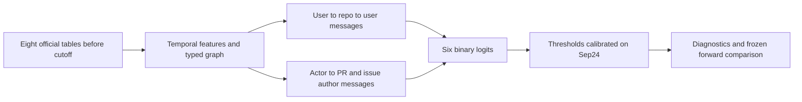

# NYCU Big Data Assignment 2

Author: Chen Jhen Tso (113700058). Individual assignment, Fall 2026.

[Step 1 in Colab](https://colab.research.google.com/github/ellatso/NYCU-BigData-Assignment2/blob/main/notebooks/Asg2_Start.ipynb) | [Step 2 graph comparison in Colab](https://colab.research.google.com/github/ellatso/NYCU-BigData-Assignment2/blob/main/notebooks/Asg2_Graph.ipynb) | [Measured results](artifacts/metrics.csv) | [Schema graph](artifacts/graphs/schema.svg) | [Entity graph](artifacts/graphs/entity_graph.svg)

This repository contains measured CPU baselines and a temporal relational graph neural network comparison. Official November predictions and presentation deliverables are pending. It uses only the instructor's official relational data. No GitHub user API or external activity data are collected.

## Quick start

The accompanying `Asg2_Start.ipynb` is self-contained: import into Kaggle/Colab, keep Internet on, and Run All. GPU is not needed. It writes this project outside the downloaded instructor-data folder and runs the benchmark, checks and graph extraction. First-run package installation/download and machine speed determine runtime; no specific runtime is guaranteed.

For local execution (from this folder):

```powershell
python -m pip install -r requirements.txt
git clone --depth 1 https://github.com/nycubigdata-2026fall/BigData2026-Assignment2.git ../assignment2_data
python -m asg2.run benchmark --data ../assignment2_data --out artifacts
python scripts/checks.py --data ../assignment2_data --out artifacts
python scripts/graphs.py --data ../assignment2_data --out artifacts/graphs
```

Graph extraction always writes DOT. SVG rendering requires Graphviz's `dot` executable (the Python package alone does not supply it). Measured SVG/PNG diagrams are already included under `artifacts/graphs/`. Local measurement used a Graphviz WebAssembly renderer because system `dot` was unavailable; the DOT input is the same.

Per-user historical prediction CSVs are kept locally and are not published here. Public evidence consists of aggregate metrics, split protocols, data hashes, checks and the assignment-required graph visualizations. Running the code generates your own local prediction files.

## What has actually run

The baseline was run on the instructor snapshot whose latest observed row timestamp is **2026-10-22 11:59:23 UTC**. `artifacts/data_manifest.json` records SHA256 for all eight files. Every parquet is read with a column allowlist. The six known-only-later fields are excluded from modeling entirely.

Training origins are Thursdays in Taiwan from May 7 to September 10, 2026 (19 weeks, 148,917 user-week samples). Calibration is September 24 (4,931 samples). Two separate historical holdout origins are October 8 and October 15 (8,731 samples total). All labels are seven-day windows. Calibration thresholds and model selection use ONLY calibration outcomes, never holdout results. A four-hour observation gap is simulated at every origin to match the final release ending Nov11 20:00 Taiwan before the Nov12 00:00 forecast start. Prior outcome windows end before the next split's observation cutoff.

Historical population is a proxy: cohort users with at least five observed target events in the previous 90 days. This does not claim to reconstruct the exact official Oct28 test cohort selection. Final prediction uses the official test IDs directly with no activity-based filtering.

| Model | Macro F1 | Micro F1 | Official combined score |
|---|---:|---:|---:|
| Last-week rule | 40.39% | 52.26% | 46.32% |
| Lifetime user features | 36.84% | 48.61% | 42.73% |
| User temporal features | 44.55% | 55.79% | 50.17% |
| Static relational features | 37.33% | 49.53% | 43.43% |
| Temporal plus relational features | 44.14% | 55.44% | 49.79% |

These are **historical validation results, not the official November score**. Temporal-only was selected by calibration. Current relational features did not improve the held-out combined score over temporal-only; this result is retained rather than hidden. Further experiments need a new untouched forward holdout as more data arrive; do not repeatedly tune to October 8/15.

## Models and features

Six LightGBM binary classifiers, one per target. Fixed seed 42, 160 trees, learning rate .045, 23 leaves, minimum leaf support 70, L2 4. The variants are:

- `static`: user age and six lifetime activity counts.
- `temporal`: adds 7/14/30/90-day counts, active days, distinct repos, last-event recency and recent/longer-term rate ratios.
- `relational`: static user features plus user-repo-user neighborhood aggregation and cross-table PR/issue-author interaction counts.
- `full`: all above plus 30-day relational aggregates.

Relations use FKs to connect activity to users/repositories and join review/discussion events to PR/issue authors. Repository activity excludes each user's own contribution when constructing neighboring activity. Non-cohort activity is incomplete by construction; neighborhood statistics describe the supplied observed graph, not complete GitHub traffic. This is relational feature aggregation followed by tree models, **not a GNN or end-to-end RDL architecture**. An explicit graph neural comparison is now implemented and measured in Step 2 below; the Step 1 aggregation model is retained as a baseline.

Thresholds are calibrated using the exact `(macro_F1 + micro_F1)/2` objective, including the official convention that an empty target with no false predictions has F1=1. Each threshold search is confined to calibration data. A simple last-week rule is included to guard against mistaking model complexity for improvement.

## Time and identity correctness

- Filter PR/issue/review rows by `first_seen_at`, and event occurrences by their own timestamps, before each prediction cutoff. A historical event learned only after cutoff cannot enter features.
- Users/repositories must also exist before cutoff. Training populations use cohort users only.
- Training labels must have occurrence within the outcome week AND availability before that week ends; retrospective records learned later are not used to train a historical model. Historical labels remain reconstructions from a released snapshot; there is no claim of access to the TAs' private truth.
- Output uses `Users.github_user_id`; table row-index PK/FK values are used only for joins within one snapshot.
- No random train/validation split. Date windows, row counts, data hashes, per-target scores, thresholds and checks are saved.
- Cache directories are keyed by data hashes. After changing feature code, remove `artifacts/cache` before rerunning, or use a new output folder.

`checks.py` has been executed: injecting future-availability records or future-occurrence records did not change past features; output IDs are stable GitHub IDs; scoring matches the official evaluator including empty-class behavior; split windows are correctly separated.

## Q1 diagrams

`artifacts/graphs/schema.svg`: all eight tables, PK/FK ports and 20 FK edges, including the self-reference in PRReviewComments. Org IDs and head-repository GitHub IDs are not row-index FKs according to the instructor schema.

`entity_graph.svg`: seed GitHub IDs 22996444 and 28983449, activity-row times in `[2026-09-15 00:00, 2026-09-17 00:00)` UTC. Blue rows are activity rows in the window; yellow nodes are seed users. Gray nodes are necessary FK endpoints that may predate the window, recursively included as context. No future rows or unrelated repo events are added. Current snapshot gives 30 nodes, 57 edges, 17 in-window activity rows. Internal row IDs may differ in subsequent releases. This is an explicit extraction convention; verify the TA's expected neighborhood definition before final slides.

## Final submission is not generated yet

Official `test_input.csv` is scheduled for Oct28. The final data release is Nov11 at 21:00 Taiwan (through 20:00); deadline is Nov11 23:55. Never submit the historical holdout CSVs as final predictions.

After final model/threshold choice is frozen and the last data release is available:

```powershell
python -m asg2.run predict --data ../assignment2_data --out artifacts --input ../assignment2_data/evaluation/test_input.csv --student-id 113700058
```

This refits the calibration-selected variant using complete historical windows from the final snapshot, keeps calibrated thresholds, writes `artifacts/output_113700058.csv`, and invokes the official evaluator with the exact test-user list. The final refit path is implemented but cannot be executed/validated against future November data today. The program refuses an October snapshot for official final prediction. Final model rankings/thresholds may change after justified development experiments; document any change and evaluate on a fresh forward holdout.

You still need a public GitHub repository, English slides using the teacher's template (<=10 pages, Q1-Q4), and a personally narrated 8-12 minute MP4. No AI-generated presentation video. Model/slide claims must match actual implementation and saved outputs.

## Source attribution

Data, schema and evaluator: https://github.com/nycubigdata-2026fall/BigData2026-Assignment2 . Model and experiment code in this package was prepared with AI assistance. No results are fabricated. Dependencies in `requirements.txt` are direct requirements; actual local versions are saved in `artifacts/environment.json`.


## Step 2 — actual relational message passing comparison

`asg2/graph.py` projects the eight relational tables to **user and repository nodes**. It does not claim to instantiate an eight-node-type graph. There are six typed user-repository activity relations, each in both directions, and three types of author interaction (issue discussion, PR review, PR line comment), each in both directions. Every message channel has its own learned linear transform. The model first aggregates user messages into repositories, then repository messages back into users; direct actor/author messages are added. All these transforms receive gradients from the six binary classification losses. There are no learned user-ID embeddings.

All graph rows, endpoints and interactions are filtered to the origin minus four hours. Edges use only the preceding 90 days. Repeated interactions receive summed `exp(-age_days/30)` weights; each receiving row is normalized separately per relation. User and repo node features contain 7/30/90-day activity counts and per-target recency, with fixed numerical scaling. Non-cohort users may be context nodes but are never treated as fully observed labeled training users.

The **user MLP ablation** uses the identical user node features, user encoder, prediction head, training windows, positive-class weights and threshold calibration; it ignores graph messages. The graph candidate adds repository and interaction messages. Fixed configuration before diagnostic scoring: hidden size 32, 8 epochs, AdamW learning rate .003, weight decay .001, dropout .15, seed 42. Training-week optimization order is seeded and shuffled; no random row train/test split is used. Loss gives each sampled historical graph equal weight, with class weights computed from training labels only.

| Candidate | Macro F1 | Micro F1 | Combined diagnostic score |
|---|---:|---:|---:|
| User MLP | 41.95% | 54.52% | 48.23% |
| Temporal relational GNN | 42.60% | 54.45% | 48.52% |
| Step 1 temporal LightGBM reference | 44.55% | 55.79% | 50.17% |

The neural pair is an apples-to-apples message-passing ablation; the LightGBM reference has a different feature design. The GNN slightly improved the neural pair's combined diagnostic score, but did not beat the temporal tree baseline. It improved macro F1 while slightly decreasing micro F1. The two diagnostic weeks disagree on the graph advantage; no robust superiority or statistical significance is claimed.

**These October 8/15 dates were already inspected in Step 1. They are now explicitly development diagnostics, not a fresh untouched test.** Calibration is still restricted to Sep24 and no diagnostic labels select epochs or thresholds. Candidate definitions are being frozen before new complete forward weeks are available. Planned forward origins: Oct22 and Oct29, Taiwan midnight; their full seven-day outcomes require releases on/after Oct29 and Nov5 respectively. `forward` reports PENDING before those outcomes are available; it never scores a partial future week. Do not repeatedly change models after reading a forward result and still call that week untouched.

```powershell
python -m pip install -r requirements_graph.txt
python -m asg2.graph_run train --data ../assignment2_data --out artifacts_step2 --device cpu
python -m unittest discover -s tests -v
python scripts/check_graph_asof.py --data ../assignment2_data --out artifacts_step2
# Later: attach/reuse the frozen checkpoints, update only the official input data,
# and evaluate without retraining these candidate models.
python -m asg2.graph_run forward --data ../assignment2_data --out artifacts_step2 --device cpu
```

For GPU use `--device cuda:0`; this code does not use DataParallel or require two GPUs. The recorded experiment was actually executed on CPU with PyTorch 2.14.1+cpu. Graph and data fingerprints isolate cached tensors. Sparse tensors, user IDs, learned checkpoints and per-user predictions remain local; only code and aggregate results are public. The forward evaluator also reports temporal LightGBM if the Step 1 checkpoint is present and its training-data manifest matches the frozen graph experiment. Preserve `artifacts/model_temporal.pkl`, its data manifest, and `artifacts_step2/*.pt` privately; the public repo deliberately excludes model binaries. The prior-data snapshot has been preserved separately to allow refitting frozen candidates from their original data if necessary.

Executed checks: normalized/empty relations; gradients through both graph hops and direct peer messages; no-graph ablation ignores edges; graph edges affect outputs; real-data features and adjacencies ignore injected future occurrence/availability records; checkpoint implementation hash matches source; future outcomes produce PENDING. Results and protocol: `artifacts_step2/metrics.csv`, `protocol.json`, `checks.json`, training histories and threshold JSONs. New future scores have not yet been measured. Step 2 neural models are not wired into the final CSV command; the implemented final prediction path remains the calibration-selected Step 1 tree candidate until a documented later selection is made.

### Graph experiment flow


